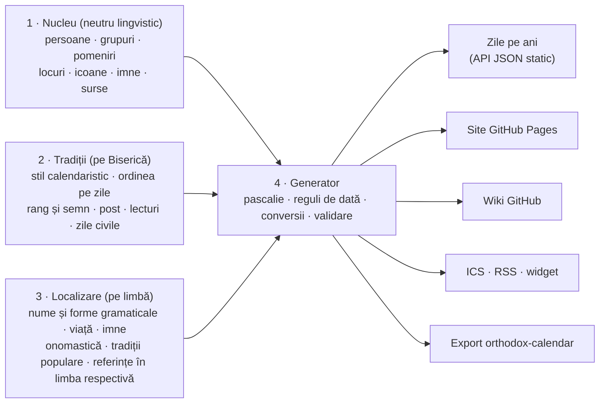

# Plan: Sinaxarul Ortodox Universal (`orthodox-synaxarion`)

> **Stare:** ciornă v0.1, 7 noiembrie 2026.
> Întrebările deschise sunt în [INTREBARI.md](INTREBARI.md). Până primesc răspunsuri, lucrez cu recomandările marcate cu ⭐ acolo.
> Analiza se bazează pe `nikolareljin/orthodox-calendar` v0.7.1 (commit `a89f0c3`) și pe site-urile de referință citite la aceeași dată.

## Decizii luate

| Întrebare | Decizie (7 noiembrie 2026) | Unde se vede în plan |
|---|---|---|
| Q1 | **Scop**: Bisericile Ortodoxe răsăritene, Bisericile Ortodoxe Orientale (copți, etiopieni, eritreeni, armeni, sirieni, malankara) și Biserica Asiriană a Răsăritului, ca familii de Biserici distincte | cinstire pe tradiție (§2, §4.1); familia tradiției (§4.4); limbi și scrieri noi (§5); calendarele copt și etiopian, pomeniri lunare, zile mobile armene (§6) |
| Q9 | **Prima versiune publică**: BOR, Patriarhia Ecumenică și Biserica Greciei, Rusia, Serbia | datele celorlalte tradiții vin după prima versiune; schema le acoperă de la început |
| Q40, Q41 | **Traduceri**: fișiere separate pe limbă, plus Markdown pentru viețile lungi | §4.13, §9 |
| Q55, Q56 | **Tehnologie**: TypeScript (validare cu Ajv, importatori, generatoare) și Astro cu Pagefind, publicat pe GitHub Pages | §10, §11 |
| restul | Recomandările ⭐ din INTREBARI.md, aplicate provizoriu în schema v0.1 (un răspuns diferit înseamnă doar o modificare de schemă) | [SCHEMA.md](SCHEMA.md) |

Decizia Q1 a ridicat patru întrebări noi (Q68–Q71 în INTREBARI.md). Cea mai importantă: cum prezentăm persoanele cinstite ca sfinți într-o familie de Biserici, dar nu și în alta.

## 0. Pe scurt

Construim un **set de date deschis, structurat și multilingv** (JSON + JSON Schema) cu toți sfinții și toate pomenirile Bisericilor Ortodoxe răsăritene și orientale și ale Bisericii Asiriene a Răsăritului, din toate țările. Din el **generăm** automat:

- un site pe GitHub Pages (multilingv, cu calendar, pagini de sfinți, căutare);
- paginile wiki ale proiectului;
- un API JSON static, fluxuri ICS (calendar) și RSS, un widget „Sfântul zilei”;
- exporturi compatibile cu `nikolareljin/orthodox-calendar`.

Cinci idei de bază, care rezultă din analiza de mai jos:

1. **Separăm entitățile**: *persoana sfântă* ≠ *pomenirea* ≠ *ziua din calendar*. În orthodox-calendar toate trei sunt amestecate într-o listă pe zile.
2. **ID-uri stabile** pentru fiecare entitate (plus Wikidata QID). Legăturile se fac prin ID, nu prin nume.
3. **Patru straturi**: nucleu neutru lingvistic → tradiții (fiecare Biserică: când, cu ce rang și cu ce semn) → localizare (fiecare limbă: nume, texte, imne, referințe proprii limbii) → date generate (zile pe ani, site, wiki, API).
4. **Data de Minei + reguli**: păstrăm data bisericească (ex. `11-07`) și reguli pentru sărbătorile mobile. Data civilă se calculează pentru stilul fiecărei Biserici (vechi, nou, copt, etiopian).
5. **Curat juridic**: preluăm fapte, scriem texte proprii și importăm doar din surse libere (Wikidata CC0, domeniu public, CC BY-SA). Restul apare doar ca link și referință.

## 1. Ce am analizat

### 1.1 `nikolareljin/orthodox-calendar` (v0.7.1, cod sub licență MIT)

Toate fișierele de date au aceeași formă, **centrată pe zi**:

```jsonc
{
  "month_day": "11-07",            // data din Minei (stil vechi pentru "julian")
  "tradition": "oca",              // greek, russian, romanian, coptic...
  "calendar": "julian",            // julian | revised | gregorian | coptic | ethiopian
  "saints": [{
    "name": "…", "title": "…",
    "feast_type": "Venerable",     // 26 de valori amestecate (vezi mai jos)
    "hagiography_url": "https://www.oca.org/saints/lives/…",
    "notes": "…",                  // extras de text (OCA / GOARCH / Wikipedia)
    "canonized_by": "…", "canonization_scope": "local", "year_canonized": 2016
  }]
}
```

| Fișier | Zile | Intrări | Calendar | Observații |
|---|---:|---:|---|---|
| `oca_julian.json` | 366 | 2.970 | julian | baza „bizantină” comună (din orthocal.info / OCA) |
| `traditions/greek_saints.json` | 366 | 1.616 | revised | plus `extended_notes`, `goarch_url` |
| `traditions/coptic_saints.json` | 366 | 751 | coptic | linkuri copticchurch.net |
| `traditions/malankara_saints.json` | 216 | 216 | gregorian | |
| `traditions/armenian_saints.json` | 144 | 144 | gregorian | plus `name_hy` |
| `traditions/ethiopian_saints.json` | 85 | 128 | ethiopian | |
| `traditions/serbian_saints.json` | 63 | 90 | julian | |
| `traditions/russian_saints.json` | 75 | 84 | julian | |
| `traditions/assyrian_saints.json` | 32 | 34 | gregorian | Biserica Asiriană a Răsăritului |
| `traditions/georgian_saints.json` | 26 | 27 | julian | |
| `traditions/bulgarian_saints.json` | 22 | 26 | revised | |
| `traditions/syriac_saints.json` | 26 | 26 | julian | |
| `traditions/romanian_saints.json` | 20 | **20** | revised | în engleză, cu link spre Wikipedia |
| `traditions/oriental_saints.json` | 6 | 6 | julian | |
| `neobyzantine_hagiographies.json` | 47 | 140 | julian | texte, nefolosite de API |
| `saints_sample.json` | 11 | 13 | mixt | exemplu |

**Ce preluăm de acolo:** lista tradițiilor cu sistemul calendaristic și data reformei (`backend/app/config.py`, ex. BOR pe stil nou din 1924-10-14), ideea de atribuire a canonizării (`canonized_by`, `canonization_scope`, `year_canonized`), suportul pentru calendarele copt și etiopian și ideile de produs (ICS, verificarea onomasticii, API REST).

**Ce trebuie rezolvat altfel:**

- **Nu există ID de sfânt.** Același sfânt apare de mai multe ori, fără legătură între înregistrări. Exemplu real: OCA are la 25 octombrie (stil vechi) *„Martyrs Marcian and Martyrius, the Notaries of Constantinople”*, iar fișierul copt are la 28 Babah *„Martyrdom of the Sts. Marcian (Marcianus) and Mercurius”*. E **aceeași zi fizică** (7 noiembrie 2026 stil nou) și foarte probabil aceeași pereche de martiri, dar sunt două înregistrări fără legătură. Planul lor de localizare (`PLAN.md` §8.7) propune ca cheie numele englezesc, ceea ce e fragil.
- **Sfântul și pomenirea sunt același lucru.** Un sfânt cu trei pomeniri (adormire, aflarea moaștelor, mutarea moaștelor) devine trei înregistrări independente.
- **`feast_type` amestecă trei lucruri**: chipul sfințeniei (*Martyr*, *Venerable*, *Hierarch*), rangul zilei (*Great Feast*, *Feast*) și tradiția (*Coptic Saint*). Are și valori ca „None” sau „Fast”.
- **Grupurile nu sunt modelate**: „33 Holy Martyrs of Melitene” e doar un șir de caractere.
- **Lipsesc** datele vieții, locurile, moaștele, imnele, icoanele, sursele, relațiile și textele în alte limbi decât engleza.
- **Sărbătorile mobile** trebuie precalculate pentru fiecare an (README-ul folderului de date).
- **Textele din `notes`** sunt copiate de pe OCA, GOARCH și Wikipedia. Licența MIT a codului **nu** acoperă aceste texte.
- **Nu e definit ce înseamnă „ortodox”**: acolo apar și Bisericile Orientale (copți, etiopieni, armeni, sirieni, malankara) și chiar Biserica Asiriană a Răsăritului, fără să fie marcate ca familii distincte. Decizia Q1 le include pe toate, dar ca familii separate, cu cinstirea înregistrată pe fiecare tradiție.

### 1.2 Site-urile de referință: ce informații arată

| Site | Organizare | Informații utile pentru schemă |
|---|---|---|
| **calendar.patriarhia.ro** (oficial BOR) | o înregistrare pe zi, 365 pe an | data; titlul zilei cu semnele **(†)**, **†)**, **†** în trei culori (**roșu**, **negru**, **albastru**); „crucea zilei”; subtitlu (zile naționale și aniversări: *Ziua Bibliei*, *Ziua națională a României*); **zi liberă legală**; Apostol și Evanghelie (referință și text integral); sinaxar (text); text suplimentar (*Tedeum*, slujbe); imagine; duminici cu nume (*Duminica a 24-a după Rusalii*), tema Evangheliei (*Învierea fiicei lui Iair*), **glas** și **voscresnă**; citiri multiple (ale zilei și ale praznicului: *al Arhanghelilor: Evrei 2, 2-10*); marcaje de post și perioade (*Dezlegare la pește*, *Lăsatul secului…*, *Începutul Postului Nașterii Domnului*), *Moșii*, *Înainte-prăznuire*, *Odovanie*. Termenii site-ului: toate drepturile rezervate, reproducerea interzisă fără acord scris. |
| **doxologia.ro** | pagină pe sfânt și pe zi | titlu, data pomenirii, viață, **tropar și condac** (plus video), canon, rugăciuni, acatist, icoane (cu proveniența), moaște, locuri de pelerinaj, articole asociate, sfinții zilei, Apostol și Evanghelie. Are un **widget** preluat de alte site-uri (ex. episcopiadevei.ro). |
| **crestinortodox.ro** | pagină pe zi sau pe grup | biografie, membrii grupului, date (naștere, adormire, **canonizare și sinodul care a canonizat**), persecutorul, minuni, „Tot astăzi facem pomenirea”, „Potrivit **Sinaxarului Sfinților de pretutindeni**” (sfinți occidentali dinainte de schismă), „Mâine facem pomenirea”, sursa, cuvinte-cheie. Include sfinți din alte Biserici (ex. Sf. Gavriil Urgebadze, canonizat de Biserica Georgiei în 2012). |
| **sinaxar.ro** | pe luni, apoi pe zile | **sinaxar audio** (cu narator), icoana zilei (cu variante), titluri prescurtate (*Sf.*, *Cuv.*, *Sf. Mc.*, *Sf. Ier.*, *Sf. Ap.*). |
| **calendar-ortodox.ro** | text de sinaxar pe zi | include **evenimente** (*pomenirea pulberii… din timpul lui Leon cel Mare*) și pomeniri care nu apar în titlu (ex. Mc. Nicandru la 6 noiembrie). Sinaxarul complet ≠ lista scurtă din calendar. |
| **ro.orthodoxwiki.org** | pagină pe zi | *Sfinții zilei*, *Evenimente* (an: descriere), *Nașteri*, *Decese*, *Sărbători*; note de ocrotire (*ocrotitorul Bulgariei*); date incerte (*una din posibilele date*); licență **GFDL / CC BY-SA**. |
| **noutati-ortodoxe.ro** | calendarul BOR pe an | semne † și (†), regim alimentar, *Zi aliturgică*, *Harți*, *Pomenirea morților*, etapa Triodului (*Canonul cel Mare, partea I*), slujbe (*Denia Prohodului*), *glas*, *voscr.*, citiri la Utrenie, zile civile (*Ziua Eroilor*), tradiții populare (*Sânzienele*), începutul anului bisericesc, durata zilei, faza lunii. |
| **st-takla.org** | sinaxarul **copt** | calendarul copt (*28 Babah 1743* = 7 noiembrie 2026); pe fiecare pomenire: titlu, tip (*Martyrdom*, *Departure*), anul (*351 AD*), persoane, locuri, text, rugăciunea de încheiere; în engleză și arabă. |
| **episcopiadevei.ro** | widgetul Doxologia | sinaxarul zilei (extrase și link), icoana zilei (*Icoana Maicii Domnului „a Bucuriei”*), Moșii, Apostolul și Evanghelia zilei. |

**Lecții concrete pentru schemă:**

- **Același sfânt are nume diferite în surse diferite**: *Lazăr din Muntele Galision* (doxologia), *Lazăr din Muntele Galisiei* (calendarul oficial BOR), *Lazarus, Wonderworker of Mount Galesius Near Ephesus* (OCA), *Lazarus the Wonderworker* (fișierul grecesc din orthodox-calendar). Avem nevoie de `variants` și de titlul oficial al fiecărei tradiții.
- **Diacritice amestecate chiar în sursa oficială**: *ş/ţ* (cu sedilă) și *ș/ț* (cu virgulă) apar în același titlu. Normalizarea trebuie făcută automat.
- **O zi conține mult mai mult decât sfinți**: Moșii, zile civile, evenimente, icoane, perioade de post, slujbe speciale, citiri multiple.
- **Lecturile nu se pot deduce naiv.** În calendarul BOR pe 2026, numerotarea duminicilor sare: 1 noiembrie e *a 22-a după Rusalii*, 8 noiembrie *a 24-a*, 29 noiembrie *a 30-a*. Denumirea urmează pericopa Evangheliei citite (saltul lucan și rânduielile de dinaintea Nașterii Domnului), iar Apostolul urmează săptămânile reale. Motorul de lecturi trebuie să reproducă exact rânduiala fiecărei Biserici sau să accepte corecții anuale din calendarul oficial.
- **Unele pomeniri depind de o dată fixă, nu de Paști**: *Sâmbăta celor adormiți – Moșii de toamnă* cade pe 7 noiembrie 2026, sâmbăta dinaintea Soborului Sfinților Arhangheli (regula exactă e de confirmat).
- **Icoanele au pomeniri proprii, prezente doar în unele surse**: *Icoana Maicii Domnului „a Bucuriei”* apare la 7 noiembrie pe doxologia, dar nu în calendarul oficial BOR.

## 2. Principii

1. **O singură sursă de adevăr**: datele stau în JSON și sunt validate cu JSON Schema. Site-ul, wiki-ul, API-ul și ICS-ul sunt **generate**, nu editate de mână.
2. **Straturi separate**: fapte neutre lingvistic, ce ține de o Biserică, ce ține de o limbă, ce se calculează.
3. **ID-uri stabile**; legăturile se fac numai prin ID.
4. **Tot ce se afișează e traductibil**: textele stau în stratul de limbă, iar codurile au etichete pe fiecare limbă, cu forme de gen și număr (*Cuviosul*, *Cuvioasa*, *Cuvioșii*).
5. **Trasabilitate și neutralitate**: fiecare afirmație importantă are sursă. Disputele (date, canonizări, jurisdicții) se înregistrează ca fapte („X a canonizat în anul Y; Z nu recunoaște”), fără judecăți.
6. **Cinstirea e pe tradiție**: aceeași persoană poate fi cinstită ca sfânt într-o familie de Biserici și nu în alta (ex. Sf. Dioscor al Alexandriei e cinstit de Bisericile Orientale, nu și de cele răsăritene). Datele nu au un câmp global „e sfânt”, ci cinstirea fiecărei tradiții; site-ul arată implicit tradiția aleasă de cititor.
7. **Curat juridic**: vezi §8.
8. **Prietenos cu contribuitorii**: un fișier pe entitate, diff-uri mici, validare automată la fiecare PR, mesaje de eroare clare.

## 3. Arhitectura: patru straturi



**Regula de bază:** straturile 1 și 2 nu conțin text de afișat, doar coduri, date, numere, ID-uri și URL-uri. Orice text de afișat stă în stratul 3.

## 4. Entitățile și câmpurile lor

> Cheile JSON sunt în engleză (proiect internațional); valorile de afișat stau în fișierele de limbă. Lista e intenționat largă: în [INTREBARI.md](INTREBARI.md) decidem ce e obligatoriu, ce e opțional și ce amânăm.

### 4.1 `person`: persoana sfântă

Include sfinții, Maica Domnului, proorocii și drepții din Vechiul Testament și îngerii (prin câmpul `kind`).

| Grup de câmpuri | Câmpuri (în nucleu) | Exemple și valori |
|---|---|---|
| Identitate | `id`, `kind`, `sex`, `aliases` (ID-uri vechi), `external_ids` | `kind`: `saint`, `theotokos`, `angel`. `sex` e necesar pentru acordul gramatical. |
| Chipul sfințeniei | `holiness_types[]` | `apostle`, `equal_to_apostles`, `prophet`, `forefather`, `righteous`, `martyr`, `great_martyr`, `hieromartyr`, `venerable`, `venerable_martyr`, `confessor`, `hierarch`, `unmercenary`, `fool_for_christ`, `passion_bearer`, `new_martyr`, `stylite`, `hermit`, `recluse`, `wonderworker`, `myrrhbearer`, `right_believing_ruler` … |
| Treaptă clericală și monahală | `ranks[]` cu `rank`, `see` (loc), `from`, `to` | `layman`, `reader`, `deacon`, `priest`, `monk`, `schemamonk`, `hieromonk`, `abbot`, `archimandrite`, `bishop`, `archbishop`, `metropolitan`, `patriarch`, `pope` |
| Ocupații și dregătorii | `occupations[]` cu `code`, `place`, `from`, `to` | `prince`, `soldier`, `notary`, `counselor` … (coduri deschise, cu etichete în vocabular) |
| Viața | `born`, `died` (dată EDTF, calendar, loc, mod), `floruit`, `era` | `died.manner`: `natural`, `martyrdom:beheading`, `martyrdom:fire` …; `era`: `apostolic`, `persecutions`, `councils`, `byzantine`, `ottoman`, `communist` … |
| Locuri | `places[]` cu `place` și `role` | `birth`, `education`, `ministry`, `ascetic_life`, `martyrdom`, `burial`, `founded` |
| Relații | `relations[]` cu `type` și `target` | `parent_of`, `child_of`, `sibling_of`, `spouse_of`, `disciple_of`, `teacher_of`, `spiritual_father_of`, `companion_of`, `ordained_by`, `successor_of`, `biographer_of` |
| Canonizare și cinstire | `veneration[]` și `canonizations[]`, ambele **pe tradiție** | fiecare `veneration` are `tradition` și `status` (`immemorial`, `canonized`, `local`, `proposed`); dacă o tradiție lipsește din listă, persoana nu e cinstită acolo. Fiecare canonizare are `church` (tradiția), `date`, `act` (ex. hotărârea sinodală), `scope` (`general`, `local`, `eparchial`) și sursă. |
| Pomeniri | nu se scriu aici: pomenirea indică persoana prin `subjects`, iar legătura inversă se calculează | adormire, aflarea sau mutarea moaștelor, proslăvire, sobor |
| Moaște | `relics[]` | `place`, `part` (`whole`, `head`, `hand`, `fragment`, `unknown`), `since`, `translations` (pomeniri), `notes` |
| Ocrotire | `patronage[]` (coduri) | profesii, boli, locuri, țări; doar cu sursă (vezi întrebările) |
| Iconografie | `iconography` | `attributes[]` (sul, cruce, suliță, balaur, roată …), veșminte, trimitere la Erminie; `images[]` (media) |
| Scrieri | `writings[]` | titlu (localizat), `cpg` sau `bhg`, linkuri |
| Imne | `hymns[]` (ID-uri) | tropar, condac … (§4.8) |
| Identificatori externi | `external_ids` | `wikidata`, `orthodoxwiki_en`, `oca`, `goarch`, `azbyka`, `drevo`, `saint_gr`, `doxologia`, `crestinortodox`, `bhg[]` (Bibliotheca Hagiographica Graeca), `upstream` (orthodox-calendar) |
| Surse și redactare | `sources[]` (ID și locul în sursă), `editorial` | `status`: `draft`, `review`, `approved`; `confidence`; `reviewed_by`; `notes` |

### 4.2 `group`: grup de sfinți sau sobor

Câmpuri: `id`, `kind` (`martyrs`, `synaxis`, `family`, `council_fathers`, `community`), `count` (exact, aproximativ sau necunoscut, ex. 33 sau „20.000”), `members[]` (persoane, cu rol, ex. `leader`), `anonymous_count`, `places`, `era`, `commemorations`.

Exemple: *Sfinții 33 de Mucenici din Melitina* (Ieron și încă 32), *Sf. Mc. Achindin, Pigasie, Aftonie, Elpidifor și Anempodist* (5 membri numiți), *Sf. Martiri și Mărturisitori Năsăudeni* (4 membri numiți, fiecare cu satul său), *Sfinții Martiri Brâncoveni* (familie și sfetnic), *Soborul Sfinților 70 de Apostoli*.

### 4.3 `commemoration`: pomenirea (ce se prăznuiește)

| Câmp | Valori și rol |
|---|---|
| `id`, `kind` | `feast_of_the_lord`, `feast_of_theotokos`, `feast_of_cross`, `synaxis_of_angels`, `saint`, `relics_translation`, `relics_finding`, `glorification`, `icon`, `council`, `event`, `memorial_saturday`, `forefeast`, `afterfeast`, `leavetaking`, `sunday` |
| `subjects[]` | persoane, grupuri, icoane, locuri |
| `date_rule` | regula implicită (§6) |
| `parent_feast` | pentru înainte-prăznuire, după-prăznuire, odovanie |
| `default_rank` | rangul tipiconal universal (§7) |
| `readings[]`, `hymns[]` | lecturi și imne proprii (tradiția le poate suprascrie) |
| `sources[]` | surse |

### 4.4 `tradition`: Biserica locală sau tradiția calendaristică

Câmpuri: `id` (slug lizibil, compatibil cu cheile din orthodox-calendar unde se poate: `romanian`, `ecumenical`, `greece`, `russian`, `serbian`, `bulgarian`, `georgian`, `antiochian`, `jerusalem`, `oca`, `rocor`, `athos`, `moldova-chisinau`, `moldova-bessarabia` …; `coptic`, `ethiopian`, `eritrean`, `armenian`, `syriac`, `malankara`; `assyrian` …), `family` (`eastern_orthodox`, `oriental_orthodox`, `church_of_the_east`), `parent`, `status` (autocefală, autonomă …), `calendar_style` (`julian`, `revised_julian`, `gregorian`, `coptic`, `ethiopian`), `paschalion` (`julian`, `gregorian`), `reform_date`, `typikon`, `lectionary` (ex. saltul lucan: da sau nu), `fasting_rules`, `symbol_legend` (semnele și culorile proprii, mapate pe rang), `languages`, `liturgical_languages`, `countries`, `official_sources`.

### 4.5 Ordinea pe zile a unei tradiții

- `traditions/romanian/menaion/11/07.json`: ce pomeniri apar, în ce ordine și cu ce semn;
- `triodion.json`, `pentecostarion.json`: ciclul mobil;
- `observances.json`: zile civile, naționale și aniversări bisericești;
- `overrides/2026.json`: corecții anuale preluate din calendarul oficial.

Titlul oficial al unei tradiții (ex. *Sf. Cuv. Lazăr din Muntele Galisiei* în calendarul BOR) e text, deci stă în stratul de limbă: `i18n/ro/traditions/romanian.json`, câmpul `official_titles`, sub cheia primei pomeniri din linie.

### 4.6 `place`: loc

Câmpuri: `id`, `kind` (`city`, `monastery`, `church`, `mountain`, `region`, `country`, `island`, `cave`), `coords`, `located_in`, `country` (ISO 3166, țara de azi), nume istorice și moderne (localizate: *Melitina → Malatya*, *Tomis → Constanța*), `wikidata`, `founded_by`.

### 4.7 `icon`: icoană făcătoare de minuni (subiect de pomenire)

Câmpuri: `id`, `subject` (`theotokos`, `christ`, `saint`), `iconographic_type` (`hodegetria`, `eleousa`, `orans`, `panachranta` …), `origin`, `location` (loc), `copies[]`, `commemorations`, `wikidata`.

### 4.8 `hymn`: imn

Câmpuri: `id`, `type` (`troparion`, `kontakion`, `ikos`, `megalynarion`, `exapostilarion`, `sessional`, `sticheron`, `irmos` …), `tone` (1–8), `podoben` (alt imn: melodia-model), `author` (persoană), `for` (pomenire). Textele stau în fișierele de limbă, cu `translation_source` și `license`. `media`: audio, partitură psaltică sau liniară.

### 4.9 Lecturi

Referințe neutre (`{"book": "LUK", "chapter": 8, "verses": "16-21"}`, cu coduri de carte USFM/OSIS), cu:

- `versification: "lxx"` (psalmii după numerotarea Septuagintei);
- `pericope` pe tradiție (zaceala);
- rolul în slujbă (`liturgy_apostle`, `liturgy_gospel`, `matins_gospel`, `vespers_paremia`, `hours` …);
- dacă lectura e „a zilei” sau „a sfântului / praznicului”.

Redarea pe limbă se face din etichete: *Ev. Luca 8, 16-21* (ro), *Luke 8:16-21* (en).

### 4.10 Post

Coduri universale: `fast_free` (harți), `no_fast`, `meat_fast` (fără carne, ca în săptămâna brânzei), `fish`, `roe` (icre), `oil_wine`, `strict` (fără ulei și vin), `xerophagy`, `total` (post negru).

Regulile (miercurea și vinerea, cele patru posturi, dezlegările de la praznice) stau în tradiție, iar generatorul calculează nivelul fiecărei zile. Etichetele sunt pe limbă (*Dezlegare la pește*, *Harți* …).

### 4.11 `source`: sursă bibliografică

Câmpuri: `id`, `type` (`book`, `article`, `website`, `synaxarion`, `menaion`, `typikon`, `prologue`, `manuscript`), titlu, autori, editură, an, limbă, ediție, ISBN, URL, `license`, `public_domain`.

Exemple: Sinaxaristul Sf. Nicodim Aghioritul (1819), Viețile Sfinților ale Sf. Dimitrie al Rostovului, Prologul de la Ohrida, Mineiele, calendarul oficial BOR pe un anumit an.

### 4.12 `media`: imagini, audio, video

Fișier sau URL (de preferat Wikimedia Commons), `license`, `author`, `source`, `credit`. Textul alternativ și legenda stau în fișierele de limbă.

### 4.13 Stratul de limbă (localizare)

Fișier `i18n/<limbă>/persons/<id>.json`, plus opțional `<id>.md` pentru viața lungă:

| Câmp | Ce conține |
|---|---|
| `names.display`, `full`, `short`, `given` | *Sf. Cuv. Lazăr din Muntele Galision* · *Sfântul Cuvios Lazăr din Muntele Galision* · *Lazăr din Galision* · *Lazăr* |
| `names.epithets[]`, `names.variants[]` | epitete; variante (*Lazăr din Muntele Galisiei*) |
| `names.secular`, `names.monastic[]` | numele de mirean, numele monahale |
| `names.forms` | `genitive` (*Sfântului Cuvios Lazăr*), `vocative` (*Sfinte Cuvioase Părinte Lazăr*): pentru titluri de acatiste și rugăciuni |
| `summary`, `synaxarion` (+ fișierul `<id>.md`) | 1–2 fraze · sinaxar scurt · viața completă, în Markdown, într-un fișier separat |
| `miracles[]`, `quotes[]` | cu sursă |
| `iconography_description` | cum se zugrăvește |
| `hymn_texts[]` | textul imnelor, cu traducerea și licența |
| `name_days` | numele care își serbează onomastica (depinde de limbă și cultură) |
| `folk_traditions[]` | marcate „tradiție populară” |
| `references[]` | **surse și linkuri specifice limbii**: pentru ro doxologia, crestinortodox, calendar.patriarhia.ro, *Viețile Sfinților*; pentru en OCA, Prologul de la Ohrida; pentru ru azbyka.ru, pravoslavie.ru; pentru el saint.gr … |
| `translation` | `status` (`draft`, `machine`, `reviewed`, `approved`), `method` (`original`, `human`, `ai_assisted`), `from`, `translators`, `reviewers`, `date` |

**Vocabularul pe limbă** (`i18n/ro/vocab.json`) conține etichetele tuturor codurilor, cu forme de gen și număr și cu abrevieri. Exemple: `venerable` → *Cuviosul / Cuvioasa / Cuvioșii / Cuvioasele*, prescurtat *Cuv.*; numele lunilor și ale zilelor; numele cărților biblice (*Ev. Luca*, *Ap. Galateni*); glasurile (*glasul 8*, *ἦχος πλ. δ'*, *глас 8*).

## 5. Limbi și traduceri

- **Coduri BCP 47**: `ro`, `en`, `el`, `ru`, `sr-Cyrl`, `sr-Latn`, `bg`, `ka`, `uk`, `mk`, `ar`, `sq`, `pl` …; pentru Bisericile Orientale și cea Asiriană și `am` (amharică), `ti` (tigrină), `hy` (armeană), `ml` (malayalam), `aii` (neo-aramaica asiriană); pentru textele liturgice originale `grc` (greaca bizantină), `el-polyton`, `cu` (slavona bisericească), `cop` (coptă), `gez` (ge'ez), `xcl` (armeana clasică) și `syc` (siriaca clasică).
- **Scriere de la dreapta la stânga** (arabă, siriacă) și fonturi pentru toate alfabetele (etiopian, armean, georgian, siriac, copt, malayalam).
- **Lanț de rezervă** pe fiecare limbă, ex. `ro-MD → ro → en`. `sr-Latn` se generează automat din `sr-Cyrl`.
- **Normalizare**: în română doar *ș/ț* cu virgulă (U+0219, U+021B), nu *ş/ţ* cu sedilă; Unicode NFC peste tot; greaca politonică doar în imne.
- **Rapoarte de acoperire** în CI: cât e tradus pe fiecare limbă, ce lipsește, ce e încă ciornă automată.
- **Traducerile automate sau asistate de AI** (dacă le acceptăm) sunt marcate explicit și nu primesc statutul `reviewed` fără revizuire umană.

## 6. Date și calendar

- **Data de Minei** (`MM-DD`) e aceeași pentru Bisericile de stil vechi și de stil nou; diferă data civilă. Stil vechi = Minei + 13 zile (1900–2099), + 14 zile din 2100. Stilul nou (iulian revizuit) coincide cu calendarul gregorian până în 2800.
- **Pascalia** e iuliană pentru toate Bisericile bizantine, cu excepția Finlandei (gregoriană). La Bisericile Orientale și la cea Asiriană se stabilește pe fiecare tradiție (de verificat una câte una), deci `paschalion` e un câmp al tradiției, nu o constantă.
- **29 februarie** (ex. Sf. Cuv. Ioan Casian): regulă de rezervă pentru anii nebisecți (de confirmat practica fiecărei Biserici).
- **Limbaj de reguli** pentru date (JSON):

```jsonc
{ "type": "fixed", "month": 11, "day": 7 }
{ "type": "pascha", "offset": -8 }                                     // Sâmbăta lui Lazăr
{ "type": "pentecost_sunday", "n": 2 }                                 // Duminica Sfinților Români (BOR)
{ "type": "weekday_before", "weekday": "saturday", "anchor": "11-08" } // Moșii de toamnă (de confirmat)
{ "type": "weekday_in_range", "weekday": "sunday", "from": "12-18", "to": "12-24" } // Duminica dinaintea Nașterii Domnului
{ "type": "monthly", "calendar": "coptic", "day": 12 }                 // pomenire lunară (ex. Arhanghelul Mihail la copți)
{ "type": "weekday_after", "weekday": "saturday", "anchor": { "commemoration": "comm:…" }, "nth": 3 } // zile mobile de tip armean (ilustrativ)
```

- **Reguli de mutare** (în stratul de tradiție). Exemplu: Sf. Mare Mc. Gheorghe; când 23 aprilie cade în Săptămâna Mare sau înainte de Paști, pomenirea se mută (de regulă în Lunea Luminată; regula exactă diferă între tradiții).
- **Datele istorice** (din viețile sfinților) în EDTF (ISO 8601-2): `1053-11-07`, `0966~` (aproximativ), `03XX` (secolul IV), `[1714,1716]` (unul dintre ani), plus `calendar: julian` sau `gregorian` explicit. Datele din Răsărit de dinainte de 1918–1924 sunt pe stil vechi.
- **Calendarele copt și etiopian** (intră în scop, Q1): conversii (13 luni; 28 Babah = 25 octombrie stil vechi = 7 noiembrie stil nou în 2026) și **pomeniri lunare** (aceeași zi din fiecare lună).
- **Calendarul armean**: majoritatea zilelor sfinților sunt mobile, așezate pe zile ale săptămânii în raport cu marile praznice (regula exactă e de verificat). Regulile de tip „a n-a sâmbătă după X” sunt deci obligatorii, nu un caz rar.
- **Zilele generate**: `build/days/<tradiție>/<an>/<MM-DD>.json`, plus un fișier pe an. **Testele „golden”** compară rezultatul cu calendarul oficial (BOR are date exacte pe fiecare zi din 2026).

## 7. Ranguri și semne

- **Ranguri tipiconale universale**: `feast_of_feasts` (Paștile), `great_feast` (praznic împărătesc), `vigil` (priveghere), `polyeleos` (polieleu), `doxology` (doxologie mare), `six_stichera` (șase stihiri), `simple`.
- **Fiecare tradiție are legenda proprie a semnelor.** În datele calendar.patriarhia.ro pe 2026, „crucea zilei” are valorile: *(†) Roșie* (21 de zile), *†) Roșie* (13), *† Roșie* (5), *†) Neagră* (9), *† Neagră* (9), *†) Albastră* (55), *† Albastră* (20), *Duminica* (42), fără semn (191). În eșantionul citit, aproape toate pomenirile marcate cu albastru sunt sfinți români; semnificația exactă e de confirmat (întrebarea Q15).
- **Separat de semn**: `public_holiday` (zi liberă legală, pe țară) și „sărbătoare cu ținere”.

## 8. Surse, licențe, drepturi

Faptele (cine, în ce zi, cu ce rang) nu sunt protejate de dreptul de autor. Sunt protejate însă **textele** (vieți, traduceri de imne, traduceri biblice), **imaginile** și, în UE, **bazele de date** (dreptul *sui generis* din Directiva 96/9/CE, preluat în Legea nr. 8/1996). Extragerea unei părți substanțiale din calendarul Patriarhiei sau din doxologia fără acord e un risc.

Politica propusă:

| Categorie | Surse | Ce facem |
|---|---|---|
| ✅ Import direct | Wikidata (CC0); texte proprii; domeniu public (Sinaxaristul Sf. Nicodim din 1819, Viețile Sfinților ale Sf. Dimitrie al Rostovului și traduceri vechi, Mineie vechi, Septuaginta); Wikipedia și OrthodoxWiki (CC BY-SA, cu atribuire) | preluăm cu atribuire, cu licența în metadate |
| ⚠️ Doar fapte, link și rezumat propriu | doxologia, crestinortodox, calendar.patriarhia.ro, OCA, GOARCH, azbyka, pravoslavie.ru, saint.gr, st-takla, copticchurch.net … | referință în `references[]`; cerem acord dacă vrem texte |
| ⚠️ orthodox-calendar | cod MIT; textele din `notes` vin de pe OCA, GOARCH, Wikipedia | îl folosim doar ca index (zi, nume, URL), nu și textele |

- **Licențe propuse**: date sub **CC0**, texte sub **CC BY-SA 4.0**, cod sub **MIT** (de confirmat în Q46–Q48).
- **Lecturile biblice**: doar referințe și link (sau traduceri din domeniul public).
- **Imnele**: originalul grecesc e liber; traducerile românești moderne (EIBMBOR) nu sunt, deci punem doar începutul imnului și link, sau cerem acord.

## 9. Identificatori și structura repo-ului

ID-urile sunt slug-uri ASCII stabile, în engleză: `lazarus-of-galesion`, `33-martyrs-of-melitene`, `nativity-of-christ`. Referințele au prefix de tip: `person:…`, `group:…`, `comm:…`, `place:…`, `src:…`. O redenumire lasă în urmă un `alias` (redirect). Codurile de vocabular (chipuri de sfințenie, ranguri, ocupații …) folosesc underscore: `great_martyr`, `gospel_book`.

```text
orthodox-synaxarion/
├─ schema/                       # JSON Schema 2020-12
│  ├─ common/                    # text localizat, date EDTF, reguli de dată, referințe, media
│  ├─ person · group · commemoration · tradition · place · icon · hymn · source · media
│  └─ i18n/                      # forma fișierelor de limbă și a vocabularului
├─ data/
│  ├─ persons/  groups/  commemorations/  places/  icons/  hymns/  sources/  media/
│  ├─ traditions/<id>/           # tradition.json · menaion/MM/DD.json · triodion · pentecostarion
│  │                             # fasting · lectionary · observances · overrides/<an>.json
│  └─ i18n/<limbă>/              # vocab.json · persons/<id>.json (+ .md) · groups/ · commemorations/ …
├─ tools/                        # validare · import (Wikidata, orthodox-calendar) · generator · export
├─ site/                         # generatorul de site (GitHub Pages)
├─ wiki/                         # șabloane pentru paginile wiki generate
└─ docs/                         # PLAN.md · INTREBARI.md · adr/ · ghiduri de contribuție și de stil
```

## 10. Unelte și validare

- **JSON Schema 2020-12**, validată cu Ajv (TypeScript) în CI la fiecare PR.
- **Verificări în plus față de schemă**: integritate referențială (orice ID folosit există), unicitate, reguli de dată valide, ș/ț corecte, NFC, formatare stabilă (ordinea cheilor), detectarea duplicatelor (nume asemănătoare în aceeași zi), verificarea periodică a linkurilor, rapoarte de acoperire pe limbi și tradiții.
- **Importatori**: Wikidata (ID-uri, nume în zeci de limbi, date, locuri, imagini), orthodox-calendar (index și URL-uri), introducere manuală.
- **Generatori**: zile pe ani, datele pentru site, paginile wiki, ICS, RSS, API JSON, JSON-LD (schema.org `Person`, `Event`, `Place`), export în formatul orthodox-calendar.

## 11. Site (GitHub Pages) și wiki

**Site-ul** (Astro, static, multilingv, cu căutare Pagefind):

- **Pagini**: *Azi*, ziua (pe tradiție), luna (grilă de calendar), sfântul, grupul, praznicul, icoana, locul, căutare, indexuri (alfabetic, pe chipuri de sfințenie, pe țări, pe secole), hartă, cronologie, onomastică, calculator de pascalie, calendar de post, descărcări, documentația API, „Contribuie”.
- **URL-uri**: `/{limbă}/sfinti/{id}/`, `/{limbă}/calendar/{tradiție}/{an}/{lună}/{zi}/`; `hreflang` între limbi; JSON-LD pentru motoarele de căutare.
- **Ieșiri**: API static `/api/v1/…`, ICS pe tradiție și limbă, RSS „Sfântul zilei”, widget pentru site-urile parohiilor (ca widgetul Doxologia preluat de episcopiadevei.ro).

**Wiki-ul** (generat de un GitHub Action în `<repo>.wiki.git`): documentația schemei (generată din JSON Schema), ghidul de contribuție, ghidul de stil pe limbi, glosarul multilingv (ro–en–el–ru–sr …) și rapoartele de acoperire. Conținutul despre sfinți stă mai bine pe site: wiki-urile GitHub au navigare limitată și, conform documentației GitHub, sunt indexate de motoarele de căutare doar în condiții speciale (de reverificat la implementare).

## 12. Ce primește un credincios

- **În fiecare zi**: sfinții zilei cu viața pe scurt, troparul și condacul (cu audio, unde avem drepturi), Apostolul și Evanghelia, postul zilei, glasul, dacă e zi aliturgică, dacă se fac nunți, Moșii, „Mâine facem pomenirea”.
- **Personal**: onomastica („cine își serbează numele azi” și căutare după nume), sfinții care îmi poartă numele, ajutor la alegerea numelui de botez, aducere-aminte pentru ziua ocrotitorului (pentru sârbi: *Slava* familiei).
- **Rugăciune**: rugăciuni și acatiste (unde avem drepturi), vocativul corect pentru rugăciunea către sfânt.
- **Pelerinaj**: harta moaștelor și a mănăstirilor, sfinții legați de un loc, hramuri.
- **Învățătură**: vieți, minuni, cuvinte de folos, scrierile Sfinților Părinți, cronologie, familii de sfinți, sfinții din țara sau orașul meu, sfinții din profesia mea.
- **Calendar**: abonare în telefon (Google, Apple, Outlook), calendar tipăribil, pascalia pe orice an, zilele libere legale.
- **Pentru parohii**: widget, export, foi de calendar pentru avizier.
- **Pentru copii**: povestiri scurte.

## 13. Etape

| Fază | Ce livrăm | Gata când |
|---|---|---|
| **0 · Decizii** | răspunsuri la INTREBARI.md → decizii (ADR) în `docs/adr/` | întrebările blocante au răspuns |
| **1 · Schema v0.1** ✅ | JSON Schema pentru toate entitățile, cele 17 exemple-test de mai jos, validator în CI (TypeScript) | livrată pe 7 noiembrie 2026: 24 de scheme, 371 de fișiere de date, 68 de teste; vezi [SCHEMA.md](SCHEMA.md) |
| **2 · Motor calendaristic** | pascalie, reguli de dată, conversii, ciclul glasurilor și al voscresnelor, post, generarea zilelor | testele „golden” pe BOR 2026 trec |
| **3 · Import și curare** | Wikidata și orthodox-calendar → entități, deduplicare, calendarul BOR complet (365 de zile) cu titluri românești | fiecare zi BOR are pomenirile legate de entități |
| **4 · Site MVP (ro + en)** | Azi, zi, lună, sfânt, căutare, ICS; publicare automată pe GitHub Pages | site public |
| **5 · Wiki și contribuții** | wiki generat, ghiduri, formulare de issue, (opțional) CMS pentru editori ne-tehnici | un voluntar poate adăuga un sfânt fără să știe JSON |
| **6 · Extinderi** | alte limbi și tradiții, imne, lecturi, hărți, onomastică, widget, export upstream | după priorități |

**Exemplele-test din faza 1** sunt alese ca să forțeze cazurile-limită, nu cazurile ușoare:

1. **Sf. Cuv. Lazăr din Muntele Galision** (7 noiembrie): variante de nume între surse.
2. **Sfinții 33 de Mucenici din Melitina** (7 noiembrie): grup cu conducător numit.
3. **Sf. Mc. Achindin, Pigasie, Aftonie, Elpidifor și Anempodist** (2 noiembrie): grup cu toți membrii numiți.
4. **Sf. Mc. Marcian și Martirie, notarii** (25 octombrie) ↔ „Marcianus și Mercurius” la copți (28 Babah): aceeași pomenire în două tradiții, sub nume diferite.
5. **Sf. Cuv. Parascheva** (14 octombrie): moaște la Iași, pelerinaj, onomastică, tradiții.
6. **Sf. Ier. Nicolae** (6 decembrie și 9 mai, mutarea moaștelor): pomeniri multiple, diferite între tradiții.
7. **Nașterea Domnului** (25 decembrie): praznic împărătesc, înainte-prăznuire, după-prăznuire, odovanie, zi liberă.
8. **Învierea Domnului și Duminica Tomii**: sărbători mobile.
9. **Sf. Mare Mc. Gheorghe** (23 aprilie): regulă de mutare.
10. **Sf. Cuv. Ioan Casian** (29 februarie): an bisect.
11. **Sfinții Martiri Brâncoveni** (16 august): sfinți români, familie, canonizați în 1992.
12. **Sf. Cuv. Mărturisitor Arsenie de la Prislop** (28 noiembrie): canonizare recentă, date moderne pe stil nou.
13. **Moșii de toamnă**: pomenire fără sfânt, legată de o dată fixă.
14. **Icoana Maicii Domnului de la Kazan** (8 iulie și 22 octombrie): icoană ca subiect, prezentă la ruși și la greci, dar nu și în calendarul BOR.
15. **Arhanghelul Mihail la copți**: pomenire lunară (ziua a 12-a a fiecărei luni copte), pe lângă praznicul anual.
16. **Sf. Grigorie Luminătorul la armeni**: pomenire mobilă a cărei regulă nu o știm încă (`unspecified`, permis doar în ciorne).
17. **Sf. Dioscor al Alexandriei**: cinstit ca sfânt de Bisericile Orientale, nu și de cele răsăritene; testează cinstirea pe tradiție.

Pe lângă ele, datele v0.1 includ Adormirea Maicii Domnului, Sf. Roman Melodul (autorul condacului Nașterii Domnului), Sf. Cuv. Gherman din Dobrogea și Sf. Doamnă Maria Brâncoveanu, care apar în același rând de calendar cu sfinții pe care îi însoțesc.

## 14. Riscuri

| Risc | Atenuare |
|---|---|
| Volum mare (zeci de mii de pomeniri) | priorități pe tradiții și limbi; pornim de la Wikidata |
| Identitate (același sfânt cu nume diferite; sfinți diferiți cu același nume) | ID-uri, Wikidata, câmpul `confidence`, pagini de dezambiguizare, revizuire |
| Drepturi de autor și dreptul asupra bazelor de date | politica din §8; acorduri scrise acolo unde vrem texte |
| Dispute între Biserici | doar fapte, cu sursă |
| Sensibilități între familiile de Biserici (persoane cinstite într-o tradiție și condamnate în alta) | cinstire pe tradiție, tradiția cititorului ca filtru implicit în site, formulări neutre, revizori din fiecare familie (Q68) |
| Calitatea traducerilor automate | marcaj explicit și revizuire umană |
| Canonizări noi în fiecare an | proces de actualizare (formular de issue „canonizare nouă”), surse oficiale |
| Complexitatea tipicului (lecturi, mutări) | corecții anuale din calendarul oficial și teste „golden” |

## Anexa A: exemple de date

Exemplele reale sunt în `data/` (v0.1), toate ca ciorne de revizuit. Pentru Sf. Cuv. Lazăr din Muntele Galision, pe care îl pomenim azi, 7 noiembrie:

| Strat | Fișier |
|---|---|
| Nucleu | [data/persons/lazarus-of-galesion.json](../data/persons/lazarus-of-galesion.json) |
| Limbă (ro) | [data/i18n/ro/persons/lazarus-of-galesion.json](../data/i18n/ro/persons/lazarus-of-galesion.json) și [viața](../data/i18n/ro/persons/lazarus-of-galesion.md) |
| Pomenire | [data/commemorations/lazarus-of-galesion--repose.json](../data/commemorations/lazarus-of-galesion--repose.json) |
| Tradiție (BOR) | [data/traditions/romanian/menaion/11/07.json](../data/traditions/romanian/menaion/11/07.json), cu titlul oficial în [data/i18n/ro/traditions/romanian.json](../data/i18n/ro/traditions/romanian.json) |
| Fapte oficiale pe 2026 | [data/traditions/romanian/overrides/2026.json](../data/traditions/romanian/overrides/2026.json) |

**Zi generată (faza 2, ilustrativ).** Așa va arăta ieșirea motorului calendaristic pentru BOR, pe 7 noiembrie 2026. Lecturile și titlul sunt cele din calendarul oficial.

```jsonc
{
  "date": "2026-11-07",
  "weekday": "saturday",
  "tradition": "romanian",
  "calendar_style": "revised_julian",
  "menaion_date": "11-07",
  "julian_date": "2026-10-25",          // la Bisericile de stil vechi, ziua civilă 7 nov. = Mineiul din 25 oct.
  "lines": [
    { "commemorations": ["comm:33-martyrs-of-melitene"] },
    { "commemorations": ["comm:lazarus-of-galesion--repose"] },
    { "commemorations": ["comm:memorial-saturday-autumn"] }
  ],
  "readings": [
    { "service": "liturgy", "role": "apostle", "ref": "2CO 8:1-5", "of": "day" },
    { "service": "liturgy", "role": "gospel", "ref": "LUK 8:16-21", "of": "day" }
  ],
  "fasting": "no_fast",
  "flags": { "public_holiday": false },
  "title": {
    "ro": "Sfinții 33 de Mucenici din Melitina; Sf. Cuv. Lazăr din Muntele Galisiei (Sâmbăta celor adormiți - Moșii de toamnă)"
  }
}
```

Pentru `russian`, aceeași zi civilă ar avea `menaion_date: "10-25"` și pomenirile de la 25 octombrie, printre ele Sf. Mc. Marcian și Martirie: exact perechea pe care copții o pomenesc tot azi, la 28 Babah. În `data/` e o singură pomenire (`comm:marcian-and-martyrius-the-notaries`), așezată în calendarul rus la 25 octombrie și în cel copt la 28 Babah.
